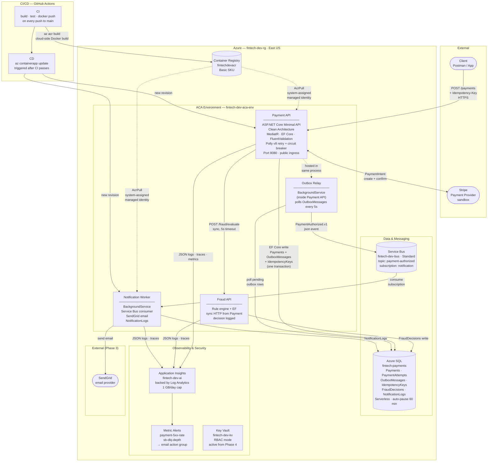
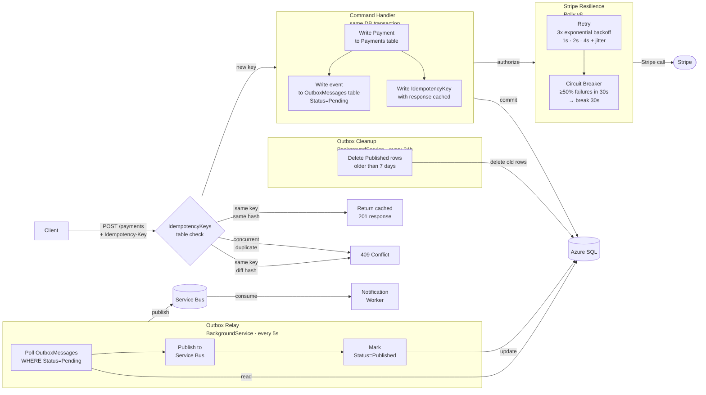
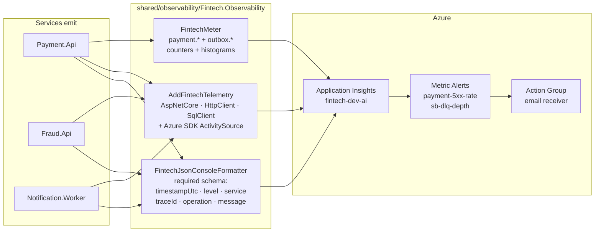

# FinTech Delivery Accelerator

A production-quality FinTech payment platform built as a reusable accelerator.

Solo backend engineer + Claude Code. Demo-first delivery across 5 phases. Target: working demo in ~6 weeks.

## What This Is

An end-to-end payment processing system demonstrating (✅ = shipped, 🔄 = in progress, ⏳ = upcoming):

- ✅ Stripe payment authorisation
- ✅ Azure Service Bus event messaging
- ✅ Transactional outbox pattern
- ✅ Idempotency and retry/circuit-breaker reliability
- ✅ Fraud rule engine (synchronous, in payment flow)
- ✅ Email notifications via SendGrid
- ✅ Structured JSON logging + OpenTelemetry distributed tracing
- ✅ Custom metrics + Azure Monitor alerts + runbook

## Stack

- **.NET 10** — ASP.NET Core minimal APIs, Clean Architecture per service
- **Azure Container Apps** — hosting, scale-to-zero
- **Azure SQL** — persistence (EF Core + Dapper)
- **Azure Service Bus** — event messaging (Standard, topics + subscriptions)
- **Stripe** — payment provider (sandbox)
- **SendGrid** — email delivery
- **Polly v8** — retry + circuit breaker
- **OpenTelemetry + Azure Monitor** — distributed tracing, custom metrics
- **Bicep** — infrastructure as code (including alerts + action groups)
- **GitHub Actions** — CI/CD (OIDC, ACR, ACA)

## Phases

| Phase | Goal | Status |
|-------|------|--------|
| 0 — Foundation | Repo, Azure, CI/CD, placeholder service | ✅ Done |
| 1 — Thin Vertical Slice | POST /payments → Stripe → SQL → Event → Notification | ✅ Done |
| 2 — Reliability | Outbox, idempotency, retry, circuit breaker | ✅ Done |
| 3 — Real System Feel | Fraud, email notifications, JSON logging, OTel, metrics + alerts | ✅ Code complete (demo validation pending) |
| 4 — Enterprise Hardening | Managed identity, private endpoints, blue-green | ⏳ Pending |

---

## Architecture

### System Overview

> **Key design decisions**
> - ACA scale-to-zero for both apps (min=0) — cost-saving for dev; outbox relay ensures no events are lost during downtime (messages stay Pending until relay comes back up)
> - Service Bus **Standard SKU** — minimum required for topics + subscriptions (Basic only has queues)
> - ACR auth via managed identity — no stored passwords anywhere in the pipeline
> - Azure SQL **Serverless** — auto-pauses after 60 min idle; expect 30-60 s cold-start on first connection
> - All secrets injected at runtime via ACA secret refs — never baked into images
> - Log Analytics capped at 1 GB/day to prevent runaway dev ingestion cost

---

### Phase 2 — Reliability Pattern ✅

Phase 1 published events directly inside the command handler — if the Service Bus call failed after the SQL write, the event was silently lost. Phase 2 replaces this with the **transactional outbox pattern** and adds full idempotency and resilience.

> **What this buys**: event delivery is atomic with the payment write. Idempotency keys prevent duplicate charges. Polly retries recover from transient Stripe errors. The circuit breaker prevents cascade failures. Concurrent duplicate requests are safe via DB-level unique constraint.

---

## Phase 0 — Foundation ✅

**Goal:** Repo structure, Azure baseline, CI/CD pipeline, placeholder service.

| Ticket | Deliverable |
|--------|-------------|
| FT-001 | Repo structure, CLAUDE.md, branch workflow |
| FT-002 | Azure resource group, ACR, ACA environment, Service Bus, Key Vault, App Insights |
| FT-003 | Bicep modules for all infra resources |
| FT-004 | GitHub Actions CI (build + Docker push) |
| FT-005 | GitHub Actions CD (ACA deploy via OIDC) |
| FT-006 | Placeholder service running on ACA |

---

## Phase 1 — Thin Vertical Slice ✅

**Goal:** Full payment flow running end-to-end in Azure: API → Stripe → SQL → Service Bus → Notification.

| Ticket | Deliverable |
|--------|-------------|
| FT-101 | Payment.Api skeleton — minimal API, health endpoint, Clean Architecture layers |
| FT-102 | `POST /payments` contract + FluentValidation |
| FT-103 | Azure SQL + Payments table (EF Core migrations, auto-run on startup) |
| FT-104 | Stripe sandbox integration — PaymentIntent create+confirm, error classification |
| FT-105 | Happy path persistence — Stripe authorize + SQL write in one handler |
| FT-106 | `PaymentAuthorized.v1` event contract (shared/contracts/) |
| FT-107 | Service Bus publisher — `IEventPublisher` abstraction, `ServiceBusEventPublisher`, `NullEventPublisher` fallback |
| FT-108 | Notification.Worker — BackgroundService consuming `PaymentAuthorized.v1` from Service Bus topic |
| FT-109 | Deploy Payment + Notification to Azure Container Apps (Bicep + CD) |
| FT-110 | Postman collection, SQL validation script, `docs/demo/phase1.md` |
| FT-111 | Phase 1 demo verified twice end-to-end on ACA |

### Phase 1 — Live Endpoint

| Service | URL |
|---------|-----|
| Payment API | `https://payment-api.gentlerock-6e5c3f99.eastus.azurecontainerapps.io` |
| Health check | `GET /health` → `{"status":"ok","service":"payment"}` |
| Notification Worker | Internal ACA worker, no public ingress |

### Phase 1 — Demo

See [`docs/demo/phase1.md`](docs/demo/phase1.md) for step-by-step instructions.

---

## Phase 2 — Reliability ✅

**Goal:** Make the payment flow production-safe: transactional outbox, idempotency keys, payment attempt tracking, Polly retry + circuit breaker.

| Ticket | Deliverable |
|--------|-------------|
| FT-201 | Schema design doc — OutboxMessages, IdempotencyKeys, PaymentAttempts |
| FT-202 | PaymentAttempts table — tracks every provider call attempt |
| FT-203 | OutboxMessages table — EF config, filtered index on Status=Pending |
| FT-204 | Outbox Relay BackgroundService — polls every 5s, publishes, marks Published |
| FT-205 | Transactional handler — outbox write replaces direct Service Bus publish |
| FT-206 | Idempotency-Key header validation — required on all POST /payments |
| FT-207 | IdempotencyKeys table — store + replay cached 201 response |
| FT-208 | Concurrency-safe idempotency — DB unique index guard, 409 on race |
| FT-209 | Polly v8 retry — 3x exponential backoff, PaymentAttempts row per attempt |
| FT-210 | Polly v8 circuit breaker — singleton, 50% failure ratio, 30s break, state logging |
| FT-211 | Provider failure simulation — dev-only `Payment:SimulateTransientFailures` config flag |
| FT-212 | Outbox cleanup service — BackgroundService, 7-day retention, `ExecuteDeleteAsync` |
| FT-213 | Phase 2 demo guide — `docs/demo/phase2.md`, four runnable demo flows |

### Phase 2 — Demo

See [`docs/demo/phase2.md`](docs/demo/phase2.md) for four runnable demo flows: outbox relay, idempotency replay, concurrent idempotency, and retry + circuit breaker.

---

## Phase 3 — Real System Feel ✅

**Goal:** Round out the platform with fraud screening, email notifications, and a production-shaped observability story.

| Ticket | Deliverable |
|--------|-------------|
| FT-301 | Fraud.Api skeleton — Domain/Application/Infrastructure, decision contract, CI/CD inclusion |
| FT-302 | Fraud rule engine — score-based decisions, EF persistence, `POST /fraud/evaluate`, 7 unit tests |
| FT-303 | Fraud integration into payment flow — synchronous, graceful degradation, declines abort before Stripe |
| FT-304 | SendGrid email on `PaymentAuthorized` — `NotificationLogs` table, idempotent delivery, null fallback |
| FT-305 | Structured JSON logging shared formatter — required schema, traceId, propagation across all three services |
| FT-306 | OpenTelemetry tracing — W3C TraceContext across HTTP + Service Bus, App Insights exporter, `X-Trace-Id` response header |
| FT-307 | Custom metrics + alerts — 8 metrics via `FintechMeter`, Payment-5xx + SB-DLQ alerts, action group, runbook |
| FT-308 | Phase 3 demo verification + accelerator extraction |

### Phase 3 — Observability Architecture

> **Trace coverage**: a single trace ID follows a payment through Payment → Fraud (HTTP) → SQL → Service Bus → Notification → SendGrid. Copy the `X-Trace-Id` response header to find the full transaction in App Insights.

### Phase 3 — Demo

See [`docs/demo/phase3.md`](docs/demo/phase3.md) for the six demo scenarios (success / failure+retry / idempotency / fraud / email / trace) and evidence checklist.

### Phase 3 — Accelerator Extraction

[`docs/accelerator/`](docs/accelerator/README.md) contains the reusable assets: `CLAUDE.md` template, Bicep modules guide, outbox + idempotency + observability patterns, phase template, and a frank list of known limitations.

---

## Getting Started

See `docs/demo/` for phase-specific demo instructions and `scripts/Validate-PaymentService.ps1` for automated local validation.

For ops triage, see [`docs/runbook.md`](docs/runbook.md).

## Rule of Thumb

Ship the simplest thing that proves the next demo. Architecture earns its complexity by paying for it in observable value.
